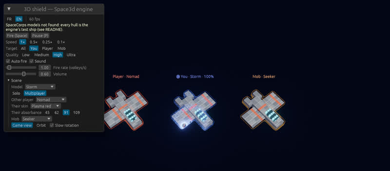

# shield_demo

A 3D shield for SpaceCorps 2027, as a Space3d example. Every ship gets a shield that hugs its hull. Each bolt makes a wave on it. The share of a hit that the shield doesn't absorb pierces it, and the shield breaks into fragments when it runs out. A group shield, the Aegis, stretches the carrier's shield into a bubble over its allies. Issue #57 records the design decisions.



## What it shows

- **Shield rendering:** a `RenderNode` (`src/node.rs`, Transparent phase, order 50) with its WGSL (`src/shield.wgsl`) draws:
  - the hull shields, one draw per ship with a 720-byte uniform at a dynamic offset;
  - the Aegis bubble with its ground ring and gauge;
  - the shield fragments, from one instanced ring buffer;
  - the bolts.

  It never writes depth, and it runs on WebGPU and WebGL2.
- **Hull envelopes:** a smooth shell at a constant distance from the hull, from a distance field. The envelope is read from a baked `.sbe` file when there is one (`src/sbe.rs`). Otherwise it is computed at load time (`src/envelope.rs`, 48 cells).
- **The game's rules** (`src/game.rs`, simulated in `Stage::FixedUpdate`):
  - Shield split: the shield takes `clamp(absorbance − penetration)` of each hit.
  - Weapons: lasers x1 to x4, Antimatter, Gemini, Lancet, blast rocket, Siphon.
  - Volleys: 2 or 4 bolts from the shooter's real gun positions.
  - Wear: one wear per volley, then break and regeneration.
  - Targets: missed shots and immune targets.
- **The Aegis:** a proposal, not a game rule yet. For 8 s, the carrier's whole shield becomes a bubble around its group, and its hull has no shield. The bubble takes its share of each hit from outside, and the rest goes on to the target. It has a reserve, a break, an end, a cooldown and fatigue.
- **The engine's quality tiers:** `GraphicsQuality::apply` and `ParticleSettings::for_quality`. The starting tier is `GraphicsQuality::recommended_for(renderer)`.
- **A French / English panel** (egui): ships, scene, target, weapon, shooter, wear, colours, shield look, sound, speed, orbit camera.

## Running it

Natively:

```bash
cargo run -p shield_demo --release
```

In the browser:

```bash
cargo build -p shield_demo --release --target wasm32-unknown-unknown
wasm-bindgen --target web --no-typescript --out-name shield_demo --out-dir examples/shield_demo/dist/web target/wasm32-unknown-unknown/release/shield_demo.wasm
cp examples/shield_demo/web/index.html examples/shield_demo/dist/web/
```

Serve `examples/shield_demo/dist/` with any static server and open `/web/`. Add `?webgl2` to the URL to take the WebGL2 path. If you have the SpaceCorps assets, put them in `dist/assets/`; the page looks for them in `../assets`.

| Input | Action |
|---|---|
| Click in the view | Fire a volley from that side |
| `Space` | Fire a volley |
| `F` | Deploy the Aegis (needs the group scene) |
| `B` / `R` | Break / restore your shield |
| `P` | Pause |
| `1`–`4` | Low, Medium, High, Ultra |
| `Esc` | Quit (desktop) |

## The SpaceCorps assets (optional)

The game's models and sounds are not in this repository. Without them, every hull is the engine's test ship (`crates/space3d-stories/assets/ship.glb`), and the demo is silent.

To see the real ships, put the files in an `assets/` folder next to the executable (`dist/assets/` on the web). You can also set `SPACE3D_SHIELD_DEMO_ASSETS` to another folder; on the web it is a URL parameter.

```text
assets/
  Storm.glb   Storm.sbe   …               one .glb per hull, .sbe optional
  sfx/hit_shield_1.mp3  laser_x1_1.mp3 …  optional, names in SFX_NAMES (src/game.rs)
```

- **Hull names:** they are listed in `src/catalog.rs`:
  - Protos, Kitefin, Ostirion, Nomad, Paragon, Miyuki, Storm, Wraith, Ironclad;
  - seeker, goombah, facet, void, phantasm, bulwark, crystalys, tesseract, inert-mass, unwakened;
  - turret, excavator.
- **Envelopes:** a `.sbe` file is a baked envelope (88 cells, smoother). Without one, the envelope is computed when the model loads.

## Scripted runs

Environment variables, or URL parameters on the web, script a run:

- **Weapon:** `SHIELD_WEAPON=x4`
- **Target:** `SHIELD_TARGET=player`
- **Aegis:** `SHIELD_AEGIS_AT=<tick>`
- **State report:** `SHIELD_LOG_FRAME=<tick>` prints one line of state in the console, and in `window.__shield` on the web.

The full list is at the top of `src/main.rs`.

A headless capture, for example:

```bash
SPACE3D_HEADLESS=1 SHIELD_SHOT=out.png SHIELD_SHOT_FRAME=300 cargo run -p shield_demo --release
```

## Tests

`cargo test -p shield_demo`

The tests load the test ship synchronously, then drive the simulation with `App::step_ticks`. They need no GPU. They cover:

- a volley making waves;
- wear down to a break, and restoring;
- the Aegis taking hits and ending;
- determinism.

## Known limits

- **Overlapping layers:** where the hull envelope folds over itself, two layers can add up. Nodes outside the Opaque phase must not write depth, so there is no depth pre-pass.
- **Bolts at 60 Hz:** bolts move on the fixed tick. Their drawn position is extrapolated to the displayed time.
